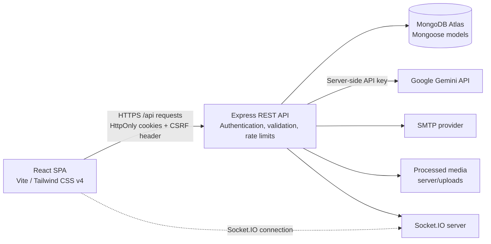

# SOCIAL AI

**SOCIAL AI — Thinks with you.**

SOCIAL AI is a social networking application that combines familiar community features with AI-assisted content tools and **Signal Intelligence**. It turns actual post discussions and recorded interactions into useful, evidence-linked insights for creators.

The project is implemented as a React single-page application and an Express API backed by MongoDB/Mongoose. Gemini requests are made by the backend; the frontend does not receive the Gemini API key.

> **Project status:** This repository contains application code and deployment configuration for Vercel and Render. A successful build or deployment configuration is not proof of a production deployment. Live deployment, SMTP delivery, and production database connectivity must be verified in the target environment.

## The problem

Social platforms provide ways to publish and react, but it can be difficult to understand what a community is actually saying, which questions remain unanswered, and what content to create next. AI writing tools may also produce recommendations without making their relationship to real audience activity clear.

## The approach

SOCIAL AI combines social publishing and interactions with backend AI workflows. Signal Intelligence analyzes stored comments and interaction data, provides evidence references for supported insights, and keeps measured metrics distinct from AI interpretation. Content generation is reviewable; generated content is not published automatically.

## Features implemented in this repository

- **Accounts and profiles:** registration, email verification, sign-in, password recovery, profile viewing and editing.
- **Feed and publishing:** feed retrieval, text and image posts, post editing and deletion, likes, bookmarks, comments, hashtags, and mentions.
- **Following:** follow relationships, follower/following views, and follow notifications.
- **Notifications:** notification retrieval and read-state management.
- **AI Studio:** generate, summarize, and refine content; suggest replies; build Content DNA variants with headlines, hashtags, short and expanded versions, and readability feedback.
- **Signal Intelligence:** Community Pulse, Audience Insights, Creator Next Move, and user-owned analysis history.
- **Evidence handling:** discussion insights are based on stored comments; returned comment references are filtered against real comment IDs.
- **Creator metrics:** post, like, comment, engagement-per-post, and hashtag metrics are calculated from stored application data. Reach and impressions are not presented because the application does not collect them.
- **Administrator workspace:** platform statistics, user administration, content moderation, audit logs, and administrator invitation management.
- **Media processing:** image uploads use Multer and Sharp for validation and processing.
- **Real-time notification events:** the API has Socket.IO notification emission paths; see the Socket.IO configuration note below for the current client/server authentication limitation.

## Signal Intelligence

Signal Intelligence is the project's main differentiator. It uses stored discussion data to help creators interpret conversations and decide what to do next:

1. **Community Pulse** summarizes themes, supportive and critical viewpoints, questions, unanswered questions, and suggestions for a selected post.
2. **Audience Insights** organizes appreciation, concerns, questions, disagreements, improvements, and themes from discussion comments.
3. **Creator Next Move** combines AI suggestions with measured creator activity, including post count, likes, comments, engagement per post, and hashtags.
4. **Analysis history** can be saved and is scoped to the authenticated user.

AI-generated statements are interpretations, not direct measurements. Evidence references point to comment IDs returned by the API; unsupported IDs are discarded. The discussion input is bounded by the backend, and outputs are validated against schemas. Do not treat generated recommendations as a substitute for reviewing the source discussion.

## Technology

| Area | Technologies |
|---|---|
| Frontend | React, JavaScript, Vite, Tailwind CSS v4, React Router |
| Backend | Node.js, Express.js |
| Database | MongoDB Atlas, Mongoose |
| Authentication | JWT, HttpOnly cookies, CSRF token protection |
| Real-time | Socket.IO and Socket.IO Client |
| AI | Google Gemini API via a backend-only integration |
| Media | Multer, Sharp |
| Validation and security | Zod, Helmet, CORS, MongoDB sanitization, rate limiting |
| Tests | Jest, Supertest, mongodb-memory-server; Vitest and Testing Library dependencies in the client |

## Architecture



The browser sends API requests to the Express service. In local development, Vite proxies `/api`, `/socket.io`, and `/uploads` to the backend. In deployment, the frontend's `VITE_API_BASE_URL` points to the Render API origin with the `/api` path. Gemini credentials belong only in the backend environment.

## Repository structure

The following is a representative outline of the current repository:

```text
.
├── client/
│   ├── public/
│   │   ├── favicon.svg
│   │   └── icons.svg
│   ├── src/
│   │   ├── api/                 # Axios client and API methods
│   │   ├── components/layout/   # User sidebar, topbar, app layout
│   │   ├── contexts/            # Auth, theme, socket, toast contexts
│   │   ├── pages/
│   │   │   ├── admin/
│   │   │   ├── auth/
│   │   │   └── dashboard/
│   │   ├── router/
│   │   ├── utils/
│   │   ├── App.jsx
│   │   └── index.css
│   ├── .env.example
│   ├── package.json
│   └── vite.config.js
├── server/
│   ├── scripts/                 # Controlled administrator maintenance commands
│   ├── src/
│   │   ├── config/
│   │   ├── controllers/
│   │   ├── middleware/
│   │   ├── models/
│   │   ├── routes/
│   │   ├── services/
│   │   ├── utils/
│   │   └── validators/
│   ├── tests/
│   ├── .env.example
│   ├── app.js
│   ├── package.json
│   └── server.js
├── render.yaml
├── vercel.json
└── README.md
```

## Prerequisites

- Node.js 22.12 or newer (or a newer supported LTS release) and npm. This satisfies the installed Vite toolchain's Node requirement; the server package does not declare a separate `engines` field.
- A MongoDB database for local application use (MongoDB Atlas or a local MongoDB instance).
- A Google Gemini API key for live AI features.
- SMTP credentials if you want to test real verification, password-reset, or administrator invitation email delivery.
- Git to clone the repository.

The backend tests use `mongodb-memory-server` and do not require your Atlas database.

## Local setup

Clone the repository and install dependencies independently for each package:

```powershell
git clone https://github.com/vignesh86-68/social-ai.git
Set-Location social-ai

Set-Location server
npm ci
Set-Location ..\client
npm ci
```

### Configure the backend

Create a backend environment file from the tracked example:

```powershell
Set-Location ..\server
Copy-Item .env.example .env
```

Edit `server/.env` locally and replace the example values with your own configuration. At minimum, configure:

- `MONGODB_URI`: your development database connection string.
- `JWT_ACCESS_SECRET` and `JWT_REFRESH_SECRET`: separate, strong random secrets.
- `COOKIE_SECRET`: a strong random signing secret.
- `GEMINI_API_KEY`: your Gemini API key, kept only on the server.
- `CLIENT_ORIGIN`: local frontend origin, normally `http://localhost:5173`.

The example also contains `PORT`, token expiration settings, optional SMTP settings, `GEMINI_MODEL`, administrator bootstrap placeholders, and `COOKIE_SAMESITE`. Replace placeholders where used. Do not commit `.env` files or share secrets in logs, screenshots, issue reports, or chat.

### Configure the frontend

For local development, leave `VITE_API_BASE_URL` empty in the client environment; Vite proxies requests to `http://localhost:5000`. If a client `.env` file is needed, start from the tracked example:

```powershell
Set-Location ..\client
Copy-Item .env.example .env
```

`VITE_API_BASE_URL` is intended for the deployed API base path, such as `https://<your-render-service>.onrender.com/api`. Do not put backend secrets in client environment variables: Vite-exposed values are included in browser assets.

### Start the services

Open two PowerShell terminals from the repository root.

Backend terminal:

```powershell
Set-Location server
npm run dev
```

Frontend terminal:

```powershell
Set-Location client
npm run dev
```

The Vite development server is configured for port `5173`; the Express server defaults to port `5000`. Check `http://localhost:5000/api/health` for the backend health endpoint and open `http://localhost:5173` for the frontend.

## Environment variable reference

Use the tracked examples as templates: [`server/.env.example`](./server/.env.example) and [`client/.env.example`](./client/.env.example). They contain placeholders, not usable credentials.

| Variable | Location | Purpose |
|---|---|---|
| `NODE_ENV` | Server | Runtime mode |
| `PORT` | Server | Express/Socket.IO listening port |
| `MONGODB_URI` | Server | MongoDB connection string |
| `JWT_ACCESS_SECRET`, `JWT_REFRESH_SECRET` | Server | Access and refresh JWT signing secrets |
| `JWT_ACCESS_EXPIRES_IN`, `JWT_REFRESH_EXPIRES_IN` | Server | Token lifetimes |
| `COOKIE_SECRET` | Server | Express signed-cookie secret and CSRF signing input |
| `COOKIE_SAMESITE` | Server | Cookie SameSite behavior; cross-site production deployments require `none` with secure cookies |
| `CLIENT_ORIGIN` | Server | Allowed frontend origin(s); CORS accepts a comma-separated list |
| `GEMINI_API_KEY` | Server only | Gemini API credential |
| `GEMINI_MODEL` | Server only | Gemini model name used by AI workflows |
| `SMTP_HOST`, `SMTP_PORT`, `SMTP_USER`, `SMTP_PASS`, `EMAIL_FROM` | Server | Optional email delivery configuration |
| `ADMIN_EMAIL`, `ADMIN_PASSWORD` | Server, controlled scripts | Runtime inputs for the one-time bootstrap script; never use example values |
| `VITE_API_BASE_URL` | Client | API base URL; empty locally to use Vite proxy, deployed value ends in `/api` |

For production, set environment variables through Render and Vercel project settings rather than committing secrets. `VITE_API_BASE_URL` is public configuration, not a secret.

## Database configuration

The backend connects to MongoDB through Mongoose using `MONGODB_URI`. The sample URI in `server/.env.example` is only a placeholder. For MongoDB Atlas:

1. Create a database user with only the permissions the application needs.
2. Allow network access from the deployed backend. Prefer an appropriately restricted network policy over unrestricted access where deployment egress permits it.
3. Use the Atlas connection string as the server's `MONGODB_URI`.
4. Select the intended database in the URI; the sample uses the database name `social-ai`.
5. Keep the URI private and never place it in frontend environment variables.

`GET /api/health` reports API process health. It is intentionally available without a ready database connection, so a successful health response alone does **not** prove MongoDB connectivity. Database-backed API operations return a service-unavailable response when the database is disconnected.

## API and Socket.IO

The API is mounted under `/api`:

| Prefix | Purpose |
|---|---|
| `/api/auth` | CSRF token, registration, login/logout, refresh, email verification, password recovery, current user, invitation acceptance |
| `/api/posts` | Feed, posts, likes, bookmarks, comments, hashtags, and mentions |
| `/api/users` | Profiles, follows, followers, and following |
| `/api/notifications` | Notification retrieval and read state |
| `/api/ai` | Content Studio, discussion summary, reply suggestions, Signal Intelligence |
| `/api/admin` | Administrator-only metrics, users, moderation, audit logs, and invitations |
| `/api/health` | API health endpoint |

Representative AI routes:

- `POST /api/ai/content-studio`
- `POST /api/ai/summarize`
- `POST /api/ai/suggest-reply`
- `POST /api/ai/signal/community-pulse`
- `POST /api/ai/signal/audience-insights`
- `GET /api/ai/signal/creator-next-move`
- `GET /api/ai/signal/history`

Protected API endpoints require authentication. AI routes also use the configured AI rate limiter and request validation. See [`server/src/routes`](./server/src/routes) for the full route definitions and middleware.

### Socket.IO implementation note

The backend creates Socket.IO on the same HTTP server, allows credentialed connections from configured frontend origins, and emits notification events to per-user rooms. The client currently calls `io('/')` and sends an empty Socket.IO auth token. The backend only joins a private room when a valid JWT is provided in the Socket.IO auth payload or Authorization header; it does not authenticate the socket from the HttpOnly cookie. Consequently, private real-time notification delivery is not currently established by the client implementation. The REST notification API remains available. Locally, Vite proxies `/socket.io` to the backend. In a separate-origin Vercel/Render deployment, the client currently has no Socket.IO backend URL setting and connects to its own origin, so Socket.IO requires implementation/configuration work before deployment. Do not assume real-time delivery is production-verified.

Locally, Vite proxies `/socket.io` with WebSocket support. CORS credentials alone do not configure the frontend to connect to the Render Socket.IO origin.

## Authentication and security

- Authentication uses short-lived access and refresh JWTs in HttpOnly cookies; browser JavaScript does not read those auth cookies.
- Cross-origin browser requests use credentialed CORS. Production cookies need `Secure` and `SameSite=None` when the frontend and API are on separate sites.
- State-changing API calls use a CSRF token issued by `GET /api/auth/csrf`; the client sends it in the `X-CSRF-Token` header.
- CORS allowlists are configured with `CLIENT_ORIGIN`. Use the exact deployed frontend origin in production.
- Server routes use authentication middleware; admin APIs additionally check the administrator role on the backend. Frontend route guards are not a replacement for server authorization.
- Request validation uses Zod. The server also enables Helmet, MongoDB query sanitization, HTTP parameter pollution protection, and API/auth/AI rate limiting.
- Gemini calls and the Gemini key remain on the backend.
- Uploaded media is validated and processed server-side. Do not trust a filename or MIME type as the only indication of file contents.
- Never commit `.env`, passwords, API keys, JWT secrets, MongoDB URIs, invitation tokens, or access tokens. Rotate any credential that is accidentally exposed.

This documentation does not constitute a security audit or production-readiness certification.

## Testing and quality checks

Run backend tests:

```powershell
Set-Location server
npm test
```

The backend test script runs Jest serially, with open-handle detection and force-exit behavior. Tests use `mongodb-memory-server` to isolate database state rather than using Atlas.

Run frontend lint and production build:

```powershell
Set-Location client
npm run lint
npm run build
```

Vitest is configured in `client/vite.config.js`, and the repository includes a router test. The client package does not currently define a `test` npm script; run the test runner directly:

```powershell
npx vitest run
```

Builds and tests validate local code only. They do not prove live provider credentials, SMTP delivery, MongoDB Atlas connectivity, or deployed behavior.

## Deployment

Deployment manifests are provided in [`render.yaml`](./render.yaml) and [`vercel.json`](./vercel.json). Configure the projects with your own provider accounts and environment variables; no deployment is performed automatically.

### Backend on Render

The included Render blueprint configures:

- Runtime: Node.js
- Root directory: `server`
- Build command: `npm ci`
- Start command: `npm start`
- Health check path: `/api/health`

Create or connect a MongoDB Atlas database, then configure the Render service variables from `server/.env.example`. At minimum, set a production `MONGODB_URI`, strong distinct JWT secrets, `COOKIE_SECRET`, `GEMINI_API_KEY`, `GEMINI_MODEL`, `CLIENT_ORIGIN` to the exact Vercel origin, `NODE_ENV=production`, and `COOKIE_SAMESITE=none`. Configure SMTP only if email delivery is required. Render supplies the service port through `PORT`.

The health endpoint does not test the database or Gemini provider. Verify an authenticated database-backed API request and an AI workflow separately after deployment.

### Frontend on Vercel

The included `vercel.json` builds the Vite app and rewrites SPA paths to `index.html`, allowing React Router routes to load directly. Configure the Vercel project with the repository root and the included build/output settings, then set:

```text
VITE_API_BASE_URL=https://<your-render-service>.onrender.com/api
```

Use the actual Render service origin. Do not add a trailing secret or place backend credentials in Vercel's `VITE_` variables. Set the Render `CLIENT_ORIGIN` to the deployed frontend's exact origin, including scheme and any required custom domain.

### Post-deployment verification

1. Open the deployed frontend and verify direct navigation/refresh on SPA routes.
2. Verify `GET <Render-origin>/api/health`.
3. Test registration/sign-in, cookie authentication, CSRF-protected state changes, refresh, and sign-out.
4. Verify a database-backed request using the deployed MongoDB configuration.
5. Test an AI endpoint with a valid backend Gemini key and model.
6. Verify email delivery if SMTP is configured.
7. Verify Socket.IO behavior separately; the current client/server token handoff limitation is documented above.

Do not announce a deployment as successful until the actual deployed URLs and workflows have been tested.

## Screenshots

Screenshots are not included in this repository documentation yet. Add genuine, current application screenshots here after capturing them; no screenshots are implied by these placeholders.

| Screen | Screenshot |
|---|---|
| Social feed | _Placeholder — add an actual screenshot_ |
| AI Studio | _Placeholder — add an actual screenshot_ |
| Signal Intelligence | _Placeholder — add an actual screenshot_ |
| Admin workspace | _Placeholder — add an actual screenshot_ |

## Future enhancements

The following are potential future work, not claims about currently implemented functionality:

- Complete and test a secure Socket.IO authentication handoff for private notifications.
- Add integration and end-to-end coverage against disposable deployment environments.
- Add operational dashboards for AI usage and service health based on persisted, real measurements.
- Add historical creator analytics only when the required event data is collected and retained.
- Publish genuine screenshots and accessibility review evidence.
- Select and document a project license.

## License

No license has been selected for this repository. Unless and until a license is added, do not assume that the code is available for reuse under an open-source license.
